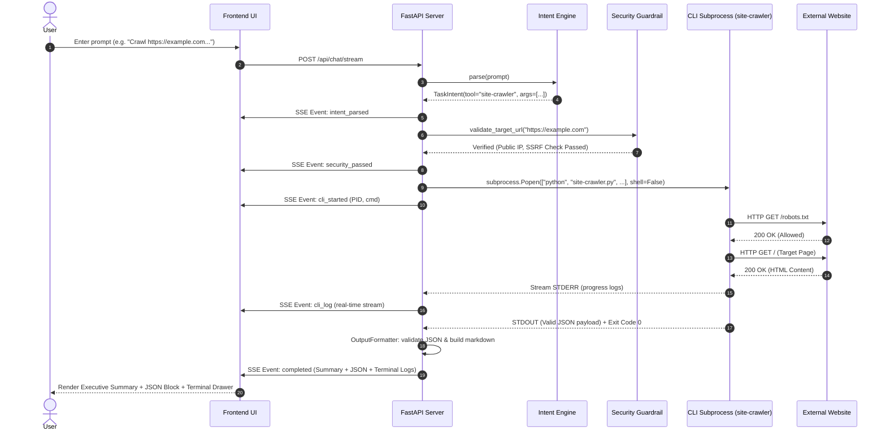

# NexusCLI — System Architecture & Engineering Design

## 1. Architectural Overview

**NexusCLI** is a conversational AI execution engine that bridges natural language human requests with real-world programmatic execution through controlled backend Command Line Interface (CLI) tools. 

Unlike standard chat applications that solely query Large Language Models for speculative text generation, NexusCLI uses a multi-tier orchestration pipeline:

```
[ User Chat Interface ] 
        │  (Natural Language Prompt)
        ▼
[ AI Intent Engine ] ────► Extracts Tool Name, URLs, Depth, Flags
        │
        ▼
[ Security Guardrail ] ──► URL Validation, SSRF Defense (Blocks RFC-1918 & Cloud Metadata)
        │
        ▼
[ Backend CLI Orchestrator ] 
        │
   ┌────┴──────────────────────────┐
   │ Isolated Python Subprocess    │
   │ Executing `site-crawler.py`   │
   │ (argv list, shell=False)     │
   └────┬──────────────────────────┘
        ├─► Real-time STDERR streaming (Live crawler progress)
        └─► STDOUT capture (Structured JSON schema)
        │
        ▼
[ Output Processing & Validation ] ──► JSON syntax verification, Schema Check
        │
        ▼
[ Response Layer ] ──► Markdown Executive Summary + Interactive JSON Inspector
```

---

## 2. Core Components

### 2.1 Web Crawler CLI Tool (`crawler/cli.py` & `site-crawler.py`)
- **Role**: Standalone, production-ready CLI binary/script capable of autonomous HTTP crawling, HTML parsing, and structured data extraction.
- **Why Selected**: Decoupled from the web server. It can be run independently in terminal environments, headless cron jobs, or containerized workers.
- **Key Capabilities**:
  - Recursive traversal with bounded depth (`--max-depth 1..3`) and page ceilings (`--max-pages 1..20`).
  - Polite crawling with delay intervals (`polite_delay`) and automatic `robots.txt` compliance verification.
  - Zero heavy external browser dependencies; uses standard, hardened HTML parsing (`WebContentParser`) to extract metadata, OpenGraph tags, headings (`h1`-`h6`), clean body paragraphs, internal/external links, and word counts.
  - Emits real-time diagnostic progress to `sys.stderr` and clean machine-readable JSON to `sys.stdout`.

### 2.2 AI Intent Understanding Layer (`backend/intent_engine.py`)
- **Role**: Translates ambiguous human instructions into deterministic CLI commands and argument lists.
- **Dual-Engine Design**:
  - **Deterministic NLP Engine**: Extracts target URLs, identifies tools (`site-crawler`, `dns-inspector`), detects traversal depth, page limits, and output preferences (JSON, summaries).
  - **Zero External Dependency Guarantee**: Fully functional without requiring paid third-party API keys or internet access for intent classification.
  - **LLM Extensibility**: Pluggable interface to OpenAI / Gemini APIs if API keys are configured in environment variables.

### 2.3 Backend CLI Orchestrator (`backend/cli_orchestrator.py`)
- **Role**: Programmatic process lifecycle manager.
- **Execution Mechanism**:
  - Spawns processes via `subprocess.Popen(cmd_list, shell=False)` using strict array-based argument passing to eliminate shell injection vulnerabilities.
  - Concurrent `stdout` and `stderr` reader threads to prevent buffer deadlocks.
  - Real-time output streaming via Server-Sent Events (SSE) to the frontend.
  - Active timeout monitor with hard killswitch (`process.kill()`) for hung requests (default: 30 seconds).
  - Captures exact Process ID (PID), execution duration (ms), exit codes, and raw output streams.

### 2.4 Security & Input Guardrails (`backend/security.py`)
- **SSRF (Server-Side Request Forgery) Defense**:
  - Resolves target hostnames via DNS and matches the resolved IP against a comprehensive denylist:
    - Loopback: `127.0.0.0/8`, `::1`
    - RFC-1918 Private Networks: `10.0.0.0/8`, `172.16.0.0/12`, `192.168.0.0/16`
    - Cloud Metadata Services: `169.254.169.254`, `169.254.0.0/16`
    - IPv6 Local/Link-Local: `fc00::/7`, `fe80::/10`
  - Blocks internal infrastructure probing with honest security notifications.
- **CLI Tool Allowlist**:
  - Restricts subprocess invocation strictly to pre-approved tools (`site-crawler`, `dns-inspector`). Any arbitrary executable request is rejected.
- **Input Sanitization**:
  - URL scheme verification (`http://`, `https://`).
  - Strips trailing punctuation, control characters, and malicious bash symbols.

### 2.5 Output Validation & Formatter (`backend/formatter.py`)
- Validates the CLI output using `json.loads` and Pydantic models.
- Separates runtime execution diagnostics (`stderr`) from structured payloads (`stdout`).
- Synthesizes an executive markdown summary alongside an interactive JSON viewer.

---

## 3. Request-Execution Sequence Flow



---

## 4. Exit Code Contract

| Exit Code | Meaning | Backend Handling |
|-----------|---------|------------------|
| `0` | Clean success | Parsed as valid JSON, rendered in chat with executive summary |
| `1` | Network/HTTP or runtime error | Reported honestly with failure details and error logs |
| `2` | Invalid CLI arguments / URL format | Input validation rejection rendered in red warning card |
| `3` | Blocked by `robots.txt` policy | Explicit policy notification returned to user |
| `-9` | Execution timeout (killed after 30s) | Terminated safely, partial logs returned |
